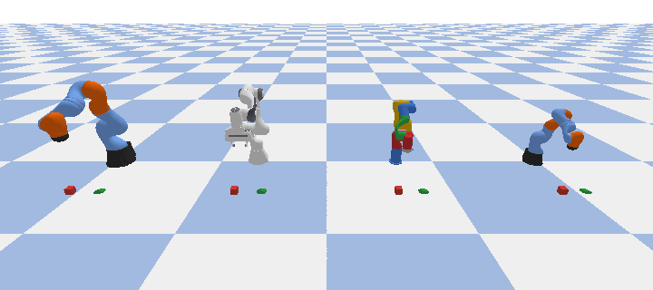

# Cross-Embodiment Transfer Lab (PyBullet)

**CSAI4014 Algorithms for Intelligent Systems and Robotics (AISR), UPES Dehradun**
Lab experiment: *Can a skill learned on one robot body be used on a different robot body?*



Four simulated arms (KUKA iiwa, Franka Panda, UFactory xArm6 and a 70%-scale KUKA) must
pick up a red cube and place it on a green goal. You will:

1. measure how different the bodies are (joints, reach, workspace),
2. try to transfer a skill by copying **joint angles** (it fails),
3. transfer it through a shared **task-space** interface (it works, when the body can reach),
4. train a neural-network policy on **one** robot and deploy it on **all** of them,
5. test whether training on **several** robots helps an **unseen** robot.

The full student manual is in **[MANUAL.md](MANUAL.md)** (also as [docs/MANUAL.pdf](docs/MANUAL.pdf)).

---

## 1. What you need

| | Minimum |
|---|---|
| OS | Windows 10/11, macOS 12+ (Intel or Apple Silicon), Ubuntu 20.04+ (or any modern Linux) |
| Python | **3.10 or 3.11** (recommended). 3.12+ works only if PyBullet builds on your machine |
| Disk / RAM | 2 GB free disk, 4 GB RAM |
| GPU | Not needed |

Why the Python version matters: PyBullet publishes ready-made *wheels* only for
**Linux x86-64 with Python 3.6 to 3.11**. On Windows and macOS, `pip` compiles PyBullet
from source (5 to 15 minutes, needs a C++ compiler). The **conda-forge** package has
prebuilt binaries for every platform, so conda is the easiest route on Windows and Mac.

---

## 2. Installation, choose ONE route

### Route A (recommended for everyone, easiest on Windows): Miniforge / conda

1. Install **Miniforge** (a small, free conda): https://github.com/conda-forge/miniforge
   * **Windows:** download `Miniforge3-Windows-x86_64.exe`, run it, keep the defaults.
     Then open **"Miniforge Prompt"** from the Start menu and use it for every command below.
   * **macOS:** open Terminal and run
     ```bash
     curl -L -O "https://github.com/conda-forge/miniforge/releases/latest/download/Miniforge3-$(uname)-$(uname -m).sh"
     ```
     ```bash
     bash Miniforge3-$(uname)-$(uname -m).sh
     ```
     Answer `yes` to the licence and to "initialize", then close and reopen Terminal.
   * **Linux:** same two commands as macOS, in a terminal.
2. Get the code (see section 3), then inside the project folder:
   ```bash
   conda env create -f environment.yml
   ```
   ```bash
   conda activate aisr-xembody
   ```
3. Check the setup (section 4).

### Route B: plain Python + venv + pip

**Linux (Ubuntu/Debian):**
```bash
sudo apt update && sudo apt install -y python3 python3-venv python3-pip git
```
```bash
python3 -m venv .venv && source .venv/bin/activate
```
```bash
pip install --upgrade pip && pip install -r requirements.txt
```
On Linux with Python 3.10/3.11 the PyBullet wheel installs in seconds. On Python 3.12+
it compiles; install `build-essential` first (`sudo apt install build-essential`).

**macOS (Intel or Apple Silicon):**
```bash
xcode-select --install
```
(installs the C++ compiler; skip if already installed), then install Python 3.11 from
https://www.python.org/downloads/ or with Homebrew (`brew install python@3.11`), and:
```bash
python3.11 -m venv .venv && source .venv/bin/activate
```
```bash
pip install --upgrade pip && pip install -r requirements.txt
```
PyBullet compiles for about 5 to 10 minutes ("Building wheel for pybullet ..."). This is normal.

> **Important on recent macOS (Xcode Command Line Tools 16 or newer, macOS 15/26):** the plain
> `pip install` fails with `_stdio.h: error: expected identifier or '('` inside `zlib/zutil.c`.
> The zlib copy bundled with PyBullet redefines `fdopen`. Install with this flag instead
> (tested on macOS 26, Apple M-series, Python 3.11, PyBullet 3.2.7):
> ```bash
> CFLAGS="-Dfdopen=fdopen" pip install -r requirements.txt
> ```
> Route A (conda) avoids the compile completely.

**Windows 10/11:**
1. Install **Python 3.11** from https://www.python.org/downloads/windows/ and tick
   **"Add python.exe to PATH"** in the installer.
2. Install **Microsoft C++ Build Tools**: https://visualstudio.microsoft.com/visual-cpp-build-tools/
   and select the workload **"Desktop development with C++"** (about 6 GB).
   Without it, `pip install pybullet` fails with `error: Microsoft Visual C++ 14.0 or greater is required`.
   If you cannot install it, use Route A instead.
3. In **PowerShell** inside the project folder:
   ```powershell
   py -3.11 -m venv .venv
   ```
   ```powershell
   .\.venv\Scripts\Activate.ps1
   ```
   ```powershell
   python -m pip install --upgrade pip; pip install -r requirements.txt
   ```
   If PowerShell refuses to run `Activate.ps1`, run
   `Set-ExecutionPolicy -Scope CurrentUser RemoteSigned` once, or use `cmd.exe` and
   `.venv\Scripts\activate.bat`.

---

## 3. Get the code

With git (the repository is private: you need to be added as a collaborator, or the
instructor shares a zip):
```bash
git clone https://github.com/reshamrajs/AISR-Cross-Embodiment-PyBullet.git
```
```bash
cd AISR-Cross-Embodiment-PyBullet
```
Without git: download the zip from the GitHub page (green **Code** button, **Download ZIP**),
unzip it and open a terminal in that folder.

---

## 4. Check the setup

```bash
python experiments/00_check_setup.py
```
Expected last line: `SETUP OK`, and a picture in `results/00_setup_snapshot.png`.
To also see the 3D window (needs a desktop session, not SSH):
```bash
python experiments/00_check_setup.py --gui
```

---

## 5. Run the experiments

| Step | Command | Time* | Output in `results/` |
|---|---|---|---|
| 0 | `python experiments/00_check_setup.py` | 2 s | `00_setup_snapshot.png` |
| 1 | `python experiments/01_explore_embodiments.py` | 10 s | `01_embodiments.csv`, `01_workspace.png`, `01_robots.png` |
| 2 | `python experiments/02_joint_space_transfer.py` | 10 s | `02_joint_space_transfer.csv`, `02_joint_space_paths.png` |
| 3 | `python experiments/03_task_space_transfer.py` | 15 s | `03_task_space_transfer.csv`, `03_task_space_paths.png` |
| 4 | `python experiments/04_learn_once_deploy_many.py` | 1.5 min | `04_learn_once_deploy_many_kuka_iiwa.csv/.png`, `models/` |
| 5 | `python experiments/05_multi_embodiment.py` | 3.5 min | `05_multi_embodiment.csv/.png` |
| demo | `python experiments/06_side_by_side_demo.py --gui` | live | (window) or `--gif` |
| bonus | `python experiments/07_teleop.py --robot xarm6` | live | drive a robot with the keyboard |
| all | `python run_all.py` (or `--quick`) | 6 min (3 to 5 min) | everything above |

\*Measured on an Apple M4 laptop CPU; older laptops may take 2 to 3 times longer. Add `--gui` to experiments 2 and 3 to watch the robots.
Every script accepts `--help`.

---

## 6. Repository layout

```
xembody/              the small library used by every experiment
  robots.py           robot registry + task-space adapter (IK, limits, tool offset)
  world.py            pick-and-place task, shared action/observation, suction gripper
  expert.py           scripted expert that only uses the shared observation
  policy.py           behaviour cloning (MLP), demo collection
  rollout.py          episodes, metrics, CSV/plots/GIF helpers
experiments/          00 ... 07, one script per step of the manual
results/              everything the scripts produce (reference results are committed)
docs/                 manual PDF and images
MANUAL.md             the lab manual (theory, procedure, observation tables, viva questions)
```

---

## 7. Troubleshooting

| Problem | Fix |
|---|---|
| `Microsoft Visual C++ 14.0 or greater is required` (Windows) | Install C++ Build Tools (Route B step 2) or use Route A (conda). |
| `pip` sits on "Building wheel for pybullet" | Normal on macOS/Windows, wait 5 to 15 minutes. |
| macOS: `_stdio.h ... error: expected identifier or '('` while building PyBullet | `CFLAGS="-Dfdopen=fdopen" pip install -r requirements.txt` (see Route B, macOS), or use Route A. |
| `No matching distribution found for pybullet` | Very new Python (3.13+) or 32-bit Python. Use Python 3.11 64-bit, or Route A. |
| `ModuleNotFoundError: No module named 'xembody'` | Run commands from the project's top folder: `python experiments/03_task_space_transfer.py`. |
| `cannot connect to X server` / GUI does not open (Linux over SSH, WSL without GUI) | Run without `--gui`; all results are saved as files. On WSL2 use Windows 11 (WSLg). |
| macOS: GUI window opens but is black or frozen | Click inside the window once; make sure you run from Terminal, not from a Jupyter notebook. |
| Keys do nothing in `07_teleop.py` | Click inside the PyBullet window first so it has keyboard focus. |
| Numbers differ slightly from the manual | Expected: physics and neural-network training differ a little across machines and library versions. Trends must match. |

---

## 8. Credits

Robot models come from `pybullet_data` (shipped with PyBullet). Prepared by Dr. Resham Raj
Shivwanshi for the AISR lab, School of Computer Science, UPES Dehradun.
